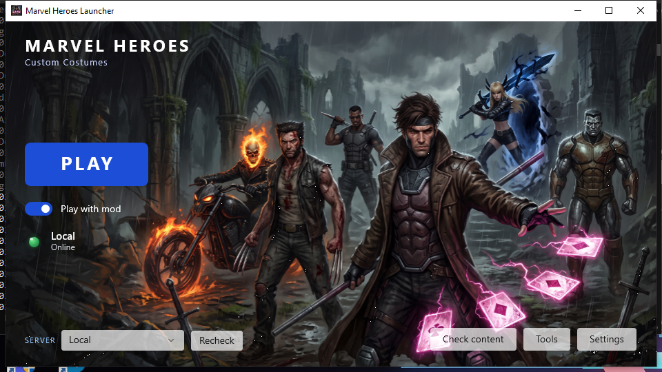

# Marvel Heroes Omega — custom costumes and effects

Custom costumes, skill effects and icons for **Marvel Heroes Omega** (shut down 2017, played
today on the [MHServerEmu](https://github.com/Crypto137/MHServerEmu) private server) that
**coexist with the stock ones**. Nothing is overwritten. A costume you add sits alongside the
originals, and a player without the mod still sees a normal game.

> **New here? Start with [docs/INTRO.md](docs/INTRO.md).**
>
> **This is not a costume** — it is the framework that makes custom costumes possible.
> INTRO.md explains what that means in practice, what you get as a player versus as a
> server owner, and how the pieces fit, without assuming you have modded this game before.



*Both tools in full, and gameplay footage of two clients proving a custom costume's effects
belong only to its wearer — **[docs/SHOWCASE.md](docs/SHOWCASE.md)**.*

## The four pieces

```
   Costume Manager  ──writes──►  CustomCostumes.mhc  ──read by──►  injected DLL
   (you, the author)                    │                          (in the game client)
                                        │
                                        └──►  ServerCostumes.json  ──►  MHServerEmu
                                                                        (the server)

   MHLauncher  ──installs content, then starts the game with the DLL injected──►  client
   (the player)
```

| Piece | Folder | What it is |
|---|---|---|
| **Injected DLL** | `src/costume-dll/` | C++, injected into the game client. Substitutes custom art for stock art at the moment the engine asks for it. → [docs/DLL.md](docs/DLL.md) |
| **Costume Manager** | `src/CostumeManager/` | WinUI 3 desktop tool. Turns a downloaded costume mod into an installable, coexisting costume. → [docs/COSTUME-MANAGER.md](docs/COSTUME-MANAGER.md) · [guide](docs/GUIDE-COSTUME-MANAGER.md) |
| **Launcher / Installer** | `src/LauncherInstaller/` | WinUI 3, ships as `MHLauncher.exe`. What a player runs: installs shared content and starts the game. → [docs/LAUNCHER.md](docs/LAUNCHER.md) · [guide](docs/GUIDE-LAUNCHER.md) |
| **Server** | `MHServerEmu/` | Modified MHServerEmu. Mints the identity a custom costume needs and puts it on the wire. → [docs/SERVER-CHANGES.md](docs/SERVER-CHANGES.md) |

Shared code: `src/core/` (install pipeline, packs, config), `src/lib/` (UPK, DDS and texture-UPK
libraries), `data/` (the generated lookup tables), `src/costume-dll/minhook/` (hooking library).

## How the trick works

The game knows every costume it shipped with. A **custom** costume exists nowhere in its data,
so the system fabricates an identity for it at every layer:

1. The **server** invents an id for the costume and sends it to the client as an ordinary
   costume change.
2. The **DLL** intercepts that id, translates it to a real "donor" costume so the client's own
   machinery is satisfied, and meanwhile loads the custom art package.
3. When the engine asks which art to render, the DLL answers with the **custom** class instead
   of the donor's.
4. Textures resolve through an alias added to the game's texture manifest, so the custom
   costume's textures are found without touching the stock ones.

The same shape covers icons, display names and per-costume visual effects.

## Documentation

| | |
|---|---|
| **[INTRO.md](docs/INTRO.md)** | **Start here.** What this is and is not, the donor concept, every feature, both audiences, distribution, safety guarantees, troubleshooting, glossary |
| [SHOWCASE.md](docs/SHOWCASE.md) | Every page of both tools, and three gameplay clips demonstrating coexistence and per-costume effect scoping in a live game |
| [GUIDE-LAUNCHER.md](docs/GUIDE-LAUNCHER.md) | Player walkthrough: first run, installing content, launching, troubleshooting |
| [GUIDE-COSTUME-MANAGER.md](docs/GUIDE-COSTUME-MANAGER.md) | Author walkthrough: install a costume, set icons, add effects, share a pack, uninstall, repair |
| [DLL.md](docs/DLL.md) | How the client mod works — hooks, the config contract, the log, the quarantine net |
| [COSTUME-MANAGER.md](docs/COSTUME-MANAGER.md) | The install pipeline: donor detection, collision renaming, TFC aliasing, icons, FX packs, the ledger |
| [LAUNCHER.md](docs/LAUNCHER.md) | What the launcher does and why it deliberately has zero project references |
| [SERVER-CHANGES.md](docs/SERVER-CHANGES.md) | Statement of modifications to MHServerEmu, as the AGPL requires |

## Building

Requires **Visual Studio 2022** with the *Universal Windows Platform development* and *Desktop
development with C++* workloads, and the **.NET 8 SDK**.

```
# shared library and the server - plain SDK is fine
dotnet build src/core/MHCostume.Core.csproj -c Release
dotnet build MHServerEmu/MHServerEmu.sln -c Release

# the two GUI apps and the DLL need Visual Studio's MSBuild
"C:\Program Files\Microsoft Visual Studio\2022\Community\MSBuild\Current\Bin\MSBuild.exe" ^
    src\CostumeManager\CostumeManager.csproj -p:Configuration=Release -p:Platform=x64 -restore
"C:\Program Files\Microsoft Visual Studio\2022\Community\MSBuild\Current\Bin\MSBuild.exe" ^
    src\LauncherInstaller\LauncherInstaller.csproj -p:Configuration=Release -p:Platform=x64 -restore
"C:\Program Files\Microsoft Visual Studio\2022\Community\MSBuild\Current\Bin\MSBuild.exe" ^
    src\costume-dll\CostumeDLL.vcxproj -p:Configuration=Release -p:Platform=x64
```

**⛔ `dotnet build` cannot build the two WinUI apps.** They need the `ExpandPriContent` task,
which ships with Visual Studio; `dotnet` looks for it under the SDK and fails with `MSB4062`
however healthy the code is. The C++ DLL likewise needs the Visual Studio toolchain.

**⛔ The DLL builds `Release|x64` only.** The property sheet that supplies MinHook
(`src/costume-dll/CommonDLLSettings.props`) is imported for that configuration alone, so the others do
not compile.

Two notes on the DLL build that look like problems and are not: `LNK4098 defaultlib 'LIBCMT'
conflicts` is expected, and a `'pwsh.exe' is not recognized` line at the very end comes from
vcpkg's machine-wide MSBuild integration, not from this project — the DLL is already written
by then.

## Licensing

- **This project's own code is source-available, not open source.** Read it, build it, run it,
  modify it for your own use — but do not redistribute it or builds of it without permission.
  Full terms in [LICENSE](LICENSE).
- `MHServerEmu/` is **AGPL-3.0** (modified from Crypto137/MHServerEmu) and that licence governs
  it regardless of the above — including your right to redistribute it. It carries its own
  `LICENSE`, and [docs/SERVER-CHANGES.md](docs/SERVER-CHANGES.md) is the statement of
  modifications the AGPL requires.
- Bundled third-party code keeps its own terms: **[THIRD-PARTY.md](THIRD-PARTY.md)**. Read the
  note about LZO there before distributing any binary built from this tree.

## Status

The costume, icon, name and per-costume effect systems all work in game. This is a hobby
project against a sealed 2017 client; expect sharp edges, and read the documentation above before
changing anything in the install pipeline — most of what looks arbitrary in there is a fix for
a specific way the client crashes.
